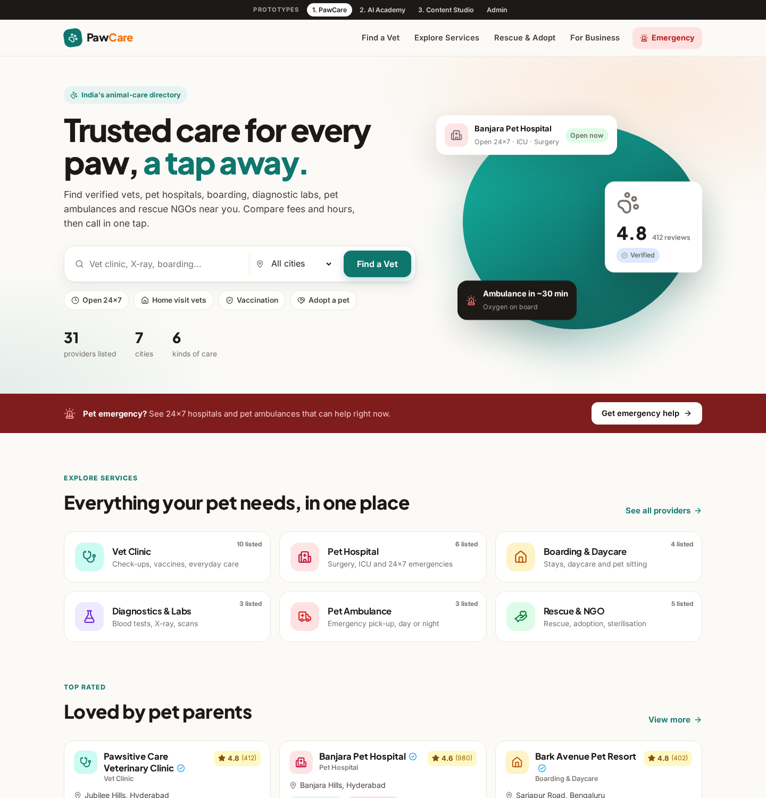
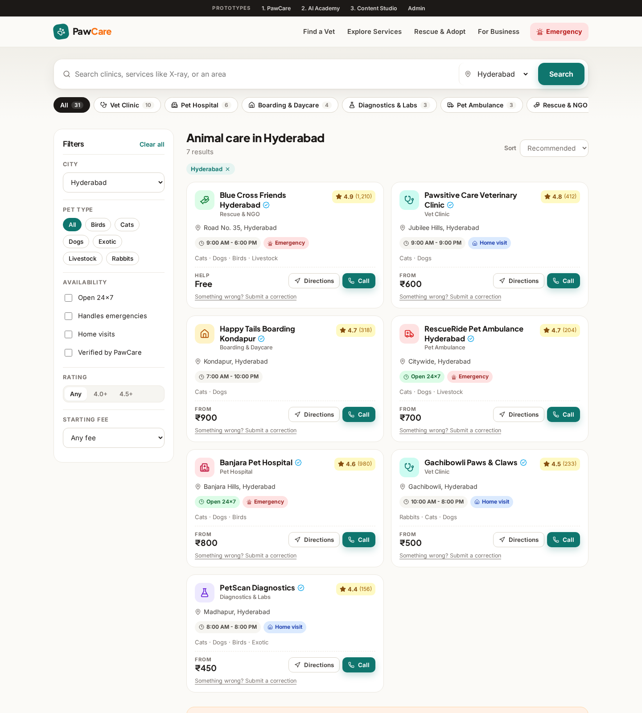
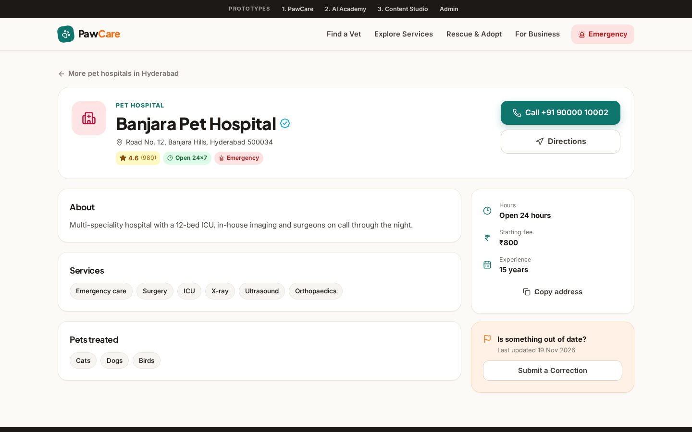
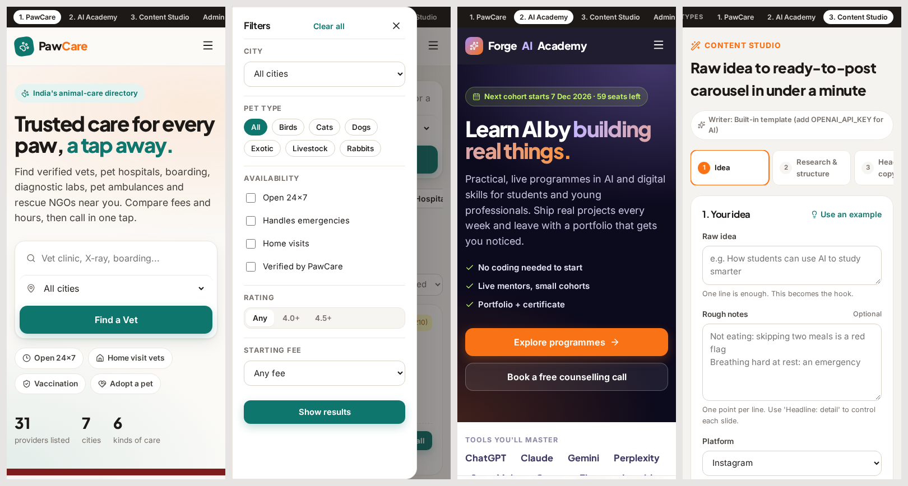
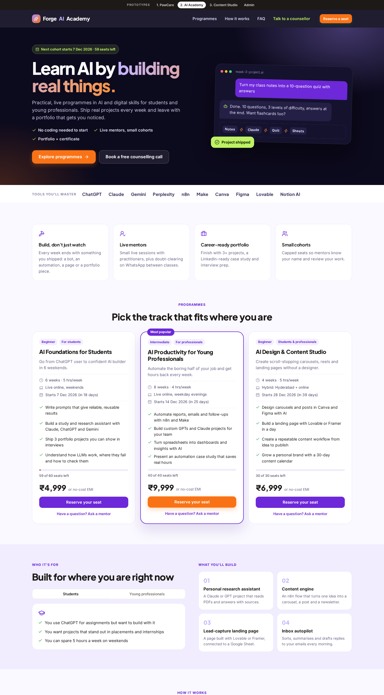
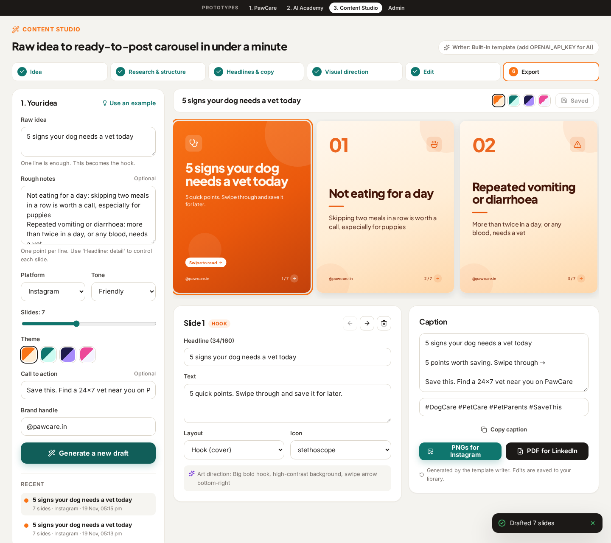
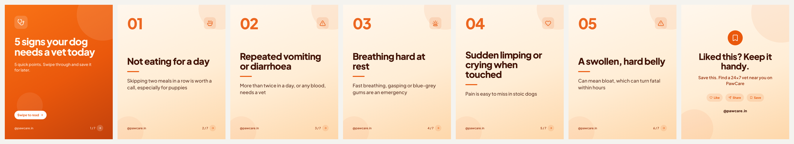
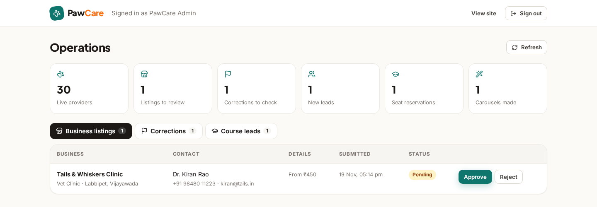

# PawCare: Practo for Animals, AI Academy and Content Studio

Working prototypes for the **Product Development, Design & AI Systems Intern** assignment, built as one full-stack app (Spring Boot + React).

| # | Assignment brief | What I built | Route |
|---|---|---|---|
| 1 | Practo for Animals: homepage / search-page prototype | **PawCare**: homepage, search with filters, provider pages, List Your Business, Submit a Correction | `/`, `/search`, `/provider/:id`, `/list-your-business` |
| 2 | AI education course landing page | **ForgeAI Academy**: landing page with live programmes, seat availability and a working enquiry + registration journey | `/academy` |
| 3 | AI-powered carousel workflow | **Content Studio**: raw idea to editable carousel to PNG/PDF export, plus the workflow write-up | `/studio`, [docs/AI_CONTENT_WORKFLOW.md](docs/AI_CONTENT_WORKFLOW.md) |
| + | | **Admin**: review new listings (approve publishes them), corrections and course leads | `/admin` |



---

## 1. PawCare (Practo for Animals)

| Search with filters | Provider page |
|---|---|
|  |  |

**Essential MVP elements**
- One search box for *what* (care type, service like "X-ray", or area) and *where* (city), on the homepage and the search page.
- Six categories: vet clinics, pet hospitals, boarding & daycare, diagnostics & labs, pet ambulances, rescue NGOs, each with a live count.
- Provider cards with what a pet parent decides on: rating and reviews, area, open 24x7 or hours, emergency, home visit, pets treated, starting fee, and one-tap **Call** and **Directions**.
- Provider page with about, services, pets treated, hours, fee, experience and a last-updated date.
- An always-visible **Emergency** path (header button, red strip, 24x7 + emergency filter) because that is the moment the product matters most.

**Filters and provider information**
City, pet type (dogs, cats, birds, rabbits, exotic, livestock), open 24x7, handles emergencies, home visits, verified, minimum rating, starting fee; sort by recommended, top rated, most reviewed or lowest fee. Filters live in the URL, so any search can be shared or bookmarked, and the back button works.

**Key CTAs**
| CTA | Where | What it does |
|---|---|---|
| Find a Vet | Hero search, nav, mobile bottom bar | Search, pre-filtered to vet clinics |
| Explore Services | Nav, category grid | Browse all six categories |
| Emergency | Nav, red strip, mobile bottom bar | 24x7 + emergency providers |
| Call / Directions | Every card and provider page | `tel:` link, Google Maps |
| List Your Business | Nav, home, search results, footer | Form, then admin review; approving publishes the provider as verified |
| Submit a Correction | Every card and provider page | Modal (phone, address, hours, fee, services, closed), reviewed in admin |

**Attractive, intuitive, mobile-first**
- Warm, trustworthy palette (teal for care, orange for action, red only for emergencies), large type, generous spacing.
- Mobile: stacked search, sticky "Find a Vet / Emergency" bar, filters in a slide-in drawer, one-column cards.
- Skeleton loaders, empty states with a way out ("Clear filters"), inline form errors, toasts.



## 2. ForgeAI Academy (course landing page)



**Page structure:** hero with the value proposition and next-cohort urgency, tools strip, four reasons to join, programme cards (from the API, with live seats left), who it's for (students / professionals toggle), projects you'll build, the journey from enquiry to demo day, FAQ, enquiry form.

**Value proposition:** "Learn AI by building real things": ship a project every week, live mentors, small cohorts, a portfolio at the end.

**CTAs:** *Reserve your seat* (primary, on every programme and in the nav), *Book a free counselling call* / *Ask a mentor* (secondary, for people not ready to commit), sticky on mobile.

**Registration and lead-capture journey**
1. Visitor arrives, often from a post: `/academy?utm_source=instagram` records where every lead came from.
2. Either **Reserve a seat** (3-step modal: programme, details, confirmation with what happens next) or **Request a callback** (enquiry form).
3. The server validates, blocks duplicate registrations for the same programme, and never overbooks a cohort (the course row is locked while a seat is taken; tested with 10 people racing for 3 seats).
4. The lead lands in **Admin > Course leads** with its source, programme and message, and moves NEW to CONTACTED to ENROLLED or LOST.
5. In production an n8n webhook on new leads would send the WhatsApp/email confirmation and book the counselling call.

## 3. Content Studio (AI carousel workflow)



Raw idea, then research & structure, headlines & copy, visual direction, edit, export. Full write-up with the workflow diagram, tool choices and costs: **[docs/AI_CONTENT_WORKFLOW.md](docs/AI_CONTENT_WORKFLOW.md)**.

- **Writer:** with `OPENAI_API_KEY` set, an OpenAI-compatible model writes the slides as strict JSON (hook, one idea per slide, CTA, caption, hashtags, art direction per slide). Without a key, or if the AI call fails, a built-in template writer turns the founder's notes into the same structure, so the studio always produces a draft.
- **Design:** four brand themes, three layouts (hook, content, CTA) and a per-slide icon. Slides render at 1080 x 1350.
- **Edit:** change any text, layout or icon, reorder, add or delete slides, switch theme, edit the caption, save to the library.
- **Export:** PNG per slide for Instagram, one PDF for a LinkedIn document carousel.

**Sample carousel** (made with the Studio, files in [docs/sample-carousel](docs/sample-carousel)):



---

## Tech stack and architecture

Same layered structure as my earlier QueueFlow project.

```
PawCare_backend/   Spring Boot 4, Java 21, Spring Data JPA, Spring Security + JWT, MySQL
  controller/      REST endpoints, no business logic
  service/         interfaces + *Impl classes with the rules (validation, seat limits, approvals)
  repository/      Spring Data repositories + ProviderSpecifications (dynamic search)
  model/           JPA entities and enums
  dto/             request/response objects with Bean Validation
  mapper/          entity to DTO mapping in one place
  ai/              CarouselWriter interface, OpenAI writer, template writer
  security/        JWT filter, JwtUtil, SecurityConfig (public vs admin routes, CORS)
  exception/       GlobalExceptionHandler, consistent JSON errors
  config/          DataSeeder (admin account + sample data)

pawcare_frontend/  React 19 + Vite, React Router, Axios, lucide icons
  main/ search/ business/ academy/ studio/ admin/   one folder per area
  services/        API calls          contextapi/   admin auth
  components/      ui + common        styles/       design tokens + per-area CSS
```

### Run it

Prerequisites: Java 21, Node 20+, MySQL 8 running locally.

**Backend (port 7681)**
```bash
cd PawCare_backend
./mvnw spring-boot:run
```
Creates `pawcare_db` on first start, loads 30 sample providers and 3 programmes, and creates the admin account. Defaults: DB user `root` / password `root` (override with `DB_USERNAME`, `DB_PASSWORD`, `DB_URL`).

**Frontend (port 6781)**
```bash
cd pawcare_frontend
npm install
npm run dev
```
Open http://localhost:6781. The API URL is in `.env.example` (`VITE_API_BASE_URL=http://localhost:7681`).

**Admin:** http://localhost:6781/admin with `admin@pawcare.in` / `Admin@123` (change with `ADMIN_EMAIL`, `ADMIN_PASSWORD`).

| Variable | Default | Purpose |
|---|---|---|
| `DB_URL`, `DB_USERNAME`, `DB_PASSWORD` | local MySQL, root/root | Database |
| `JWT_SECRET` | random per run | Admin token signing (32+ characters) |
| `ADMIN_EMAIL`, `ADMIN_PASSWORD` | admin@pawcare.in / Admin@123 | Admin account created on first start |
| `OPENAI_API_KEY` | empty (template writer) | Turns on the AI writer in the Studio |
| `OPENAI_MODEL`, `OPENAI_BASE_URL` | gpt-4o-mini, OpenAI | Any OpenAI-compatible API |
| `CORS_ALLOWED_ORIGINS` | http://localhost:6781 | Frontend origin |
| `SEED_DEMO_DATA` | true | Load sample providers and courses into an empty database |

### API

| Method | Endpoint | Access |
|---|---|---|
| GET | `/api/providers?q=&city=&category=&species=&open24x7=&emergency=&homeVisit=&verified=&minRating=&maxFee=&sort=&page=&size=` | Public |
| GET | `/api/providers/{id}`, `/api/providers/meta`, `/api/providers/featured` | Public |
| POST | `/api/listings` (List Your Business), `/api/corrections`, `/api/leads` | Public |
| GET | `/api/courses`, `/api/courses/{slug}` | Public |
| POST / GET / PUT | `/api/carousels/generate`, `/api/carousels`, `/api/carousels/{id}`, `/api/carousels/engine` | Public (Studio) |
| POST | `/api/auth/login` | Public |
| GET / PATCH | `/api/admin/summary`, `/api/admin/listings[/{id}/status]`, `/api/admin/corrections[/{id}/status]`, `/api/admin/leads[/{id}/status]` | Admin JWT |
| DELETE | `/api/admin/carousels/{id}` | Admin JWT |

Errors are JSON: `{"error": "..."}`, or `{"field": "message"}` for validation, which the forms show under each field.

### Tests

```bash
cd PawCare_backend && ./mvnw test
```
30 tests on an in-memory H2 database (no MySQL needed): search filters, wildcard escaping, sorting and paging limits; approving a listing publishes it once; corrections; duplicate registrations; **10 concurrent registrations for 3 seats book exactly 3**; carousel generate, edit and reload; admin login; the template writer; JWT.

### Notes

- Provider names, phone numbers and reviews are **sample data** for the prototype, not real businesses.
- The Studio is public so reviewers can try it; in production it would sit behind the founder's login.
- Admin JWT is kept in `localStorage` for simplicity; an httpOnly cookie would be the production choice.


