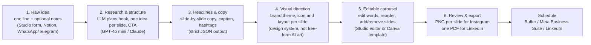

# AI-Powered Content Creation System

Goal: the founder turns a raw idea into a ready-to-publish Instagram or LinkedIn carousel on their own, in minutes, without an in-house designer.

The repo contains a working version of this workflow (the **Content Studio** at `/studio`), plus the no-code version below for when the team wants to run it from a phone or a Telegram/WhatsApp message.

## The workflow

| Step | What happens | In this repo | No-code equivalent |
|---|---|---|---|
| 1. Idea | Founder writes one line, optionally a few rough notes (one per line). | Studio form, "Use an example" | Notion database row, or a WhatsApp/Telegram message to a bot |
| 2. Research & structure | The model checks the facts it knows and plans the story: a hook, one idea per slide, a call to action. It is told not to invent statistics or medical claims. | `OpenAiCarouselWriter` system prompt | n8n **OpenAI** or **Anthropic** node, or Make **OpenAI** module |
| 3. Copy | Headlines (max 9 words), one supporting line (max 28 words), caption and hashtags, returned as strict JSON so nothing has to be copy-pasted. | `response_format: json_object`, validated and clamped in `toDraft()` | Same prompt, "Parse JSON" step |
| 4. Visual direction | Every slide gets a layout (HOOK / CONTENT / CTA), an icon and art-direction notes. Colours and fonts come from fixed brand themes, so every post looks on-brand. | `SlideCanvas.jsx` + `themes.js` (4 themes) | Canva **Brand Kit** + a carousel template, filled with **Bulk Create** (CSV) or the Canva Connect API; or a Figma template filled by a plugin |
| 5. Edit | The founder fixes any word, swaps icons, reorders, adds or deletes slides, changes theme, then saves. | Studio editor (`PUT /api/carousels/{id}`) | Edit the generated Canva design |
| 6. Export | 1080 x 1350 (4:5) PNG per slide for Instagram, or one PDF for a LinkedIn document carousel. | `html-to-image` + `jsPDF` | Canva download (PNG / PDF) |
| Publish | Schedule for the best time. | Copy caption button | Buffer, Meta Business Suite, LinkedIn scheduler |

## Why this design

- **Copy is AI, layout is a design system.** Image models are inconsistent with text and branding. Keeping layout in fixed templates means every carousel is readable and on-brand, and the founder only ever reviews words.
- **Strict JSON between steps.** The writer returns a fixed shape (`title`, `caption`, `hashtags`, `slides[]`), so the same editor and exporter work whichever model wrote it.
- **Always works.** With no API key, or if the AI call times out, a built-in template writer turns the founder's notes into the same structure, so the studio never shows an error instead of a draft.
- **The model is swappable.** `OPENAI_BASE_URL` points at any OpenAI-compatible API (OpenAI, Azure OpenAI, OpenRouter, a local model), and the `CarouselWriter` interface makes adding a Claude or Gemini writer a single class.
- **Human in the loop.** Nothing is published automatically. The founder reviews every slide before export.

## Recommended tools

| Job | Pick | Why |
|---|---|---|
| Research & copy | ChatGPT (GPT-4o mini via API) or Claude | Cheap, fast, good at structured JSON; Claude for longer research |
| Fact check (health topics) | Perplexity | Cited sources for anything medical |
| Design system | Canva Pro (Brand Kit + templates) or this Studio | Founder can edit without design skills |
| Automation | n8n (self-hosted, free) or Make | Connect Notion/WhatsApp -> AI -> Canva/Studio -> Drive |
| Storage | Google Drive or Notion | Library of past carousels |
| Scheduling | Buffer | Instagram + LinkedIn from one queue |

Rough running cost: under Rs. 500 a month in API calls for daily posting with GPT-4o mini, plus Canva Pro and Buffer if used.

## The sample carousel

`docs/sample-carousel/` holds a carousel made end-to-end with the Studio:

- Idea: *5 signs your dog needs a vet today*
- Notes: five one-line points (the "Use an example" button fills them in)
- Platform: Instagram, tone Friendly, theme Sunrise, CTA "Save this. Find a 24x7 vet near you on PawCare"
- Writer: the built-in template writer (no API key), so anyone can reproduce it exactly; with `OPENAI_API_KEY` set, the same click runs through the AI writer
- Output: 7 PNGs (1080 x 1350) and the same carousel as a LinkedIn PDF

It ties the content back to the product: the CTA sends readers to PawCare's 24x7 search.
